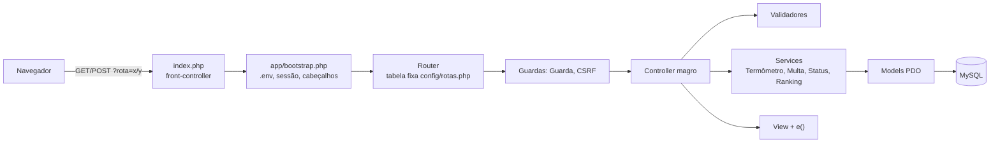

# FiscalPulse — Gestão Contábil & Termômetro de Risco Fiscal

Sistema web para **escritórios de contabilidade** gerenciarem empresas-clientes e obrigações fiscais,
com um **Termômetro de Risco Fiscal** (score de 0 a 100% e estimativa de multa por atraso) que mostra
ao empresário, de forma visual, o quanto o atraso custa — para engajar o cliente e evitar inadimplência.

Stack: **PHP 8.2 puro** (MVC estrito, front-controller `index.php`, sem frameworks e sem Composer) ·
**MySQL/MariaDB** via PDO com prepared statements · HTML5/CSS3 + **Bootstrap 5** (CDN) ·
**JavaScript puro** (velocímetro em SVG) · executor de testes próprio (`testes.php`).

---

## 1. Instalação (XAMPP, Windows)

Requisitos: XAMPP com **PHP 8.2+**, Apache (com `mod_rewrite` e `AllowOverride All`, o padrão) e MySQL/MariaDB.

1. Copie a pasta para `C:\xampp\htdocs\sistema_contabil`.
2. No painel do XAMPP, inicie **Apache** e **MySQL**.
3. Em `http://localhost/phpmyadmin`, aba **Importar**, importe o arquivo `database.sql`
   (cria o banco `fiscalpulse` com dados de exemplo; é seguro reimportar para voltar ao estado inicial).
4. Copie `.env.example` para `.env`. O padrão do XAMPP (usuário `root`, sem senha) já funciona.
   Para uma demonstração/entrega, troque `APP_ENV=desenvolvimento` por `APP_ENV=producao`
   (esconde mensagens de erro do PHP; os detalhes vão só para `storage/logs/`).
5. Abra **http://localhost/sistema_contabil/**.

### Usuários de teste

| Perfil | E-mail | Senha | O que vê |
|---|---|---|---|
| Contador | `contador@fiscalpulse.test` | `Contador@123` | Ranking de risco, todas as empresas, cadastros, avaliações |
| Cliente (Padaria — risco **crítico**) | `cliente1@fiscalpulse.test` | `Cliente@123` | Só a própria empresa |
| Cliente (Tech — risco **baixo**) | `cliente2@fiscalpulse.test` | `Cliente@123` | Só a própria empresa |

As datas do seed são relativas a "hoje", então a demonstração sempre mostra obrigações atrasadas e a vencer.

### Roteiro de demonstração (2 minutos)

1. Entre como **contador**: o painel mostra o ranking (Padaria 100%, Tech 26%, Clínica 0%) e a multa estimada total.
2. Abra **Termômetro** da Padaria: velocímetro, multa de R$ 145,70 e a tabela de atrasos.
3. Em **Obrigações → Pagar** (DAS e FGTS): o score cai e o ranking muda.
4. **Empresas → Nova empresa**, depois **Novo usuário** na página da empresa: crie um cliente e entre com ele.
5. Como **cliente**: veja o termômetro e as próximas obrigações; tente abrir a empresa de outro cliente (**403**).
6. **Avaliar o sistema** (botão amarelo na barra): nota de 1 a 5 e comentário — o contador vê em **Avaliações**.

---

## 2. Como o Termômetro funciona (premissas do MVP)

São regras **simples e explicáveis ao cliente**; não substituem o cálculo oficial da Receita Federal.

**Risco de cada obrigação em aberto (0–100):**

| Situação | Risco |
|---|---|
| Vence em mais de 15 dias | 0 |
| Vence em 0 a 15 dias | sobe de 0 a 30 (2 pontos por dia que se aproxima) |
| Atrasada | `40 + 4 × dias de atraso` (100 com 15 dias) |

**Score da empresa** = pior risco + 25% da soma dos demais (limitado a 100).
**Faixas:** 0–29 baixo (verde) · 30–59 atenção (amarelo) · 60–79 alto (laranja) · 80–100 crítico (vermelho).

**Multa estimada (só atrasadas):** multa de 0,33% ao dia, teto de 20% + juros de 1% ao mês proporcionais aos dias.
Ex.: R$ 1.000,00 com 10 dias = R$ 33,00 + R$ 3,33 = **R$ 36,33**. Todo cálculo usa **centavos inteiros**
(sem ponto flutuante). A **data de vencimento** manda: uma obrigação "pendente" já vencida conta como atrasada.

---

## 3. Arquitetura



```
index.php  testes.php  database.sql  .env.example  .htaccess
config/rotas.php            tabela única de rotas: rota + método -> controller@ação + nível de acesso
app/Core/                   Router, Request, View, Auth, Guarda, Csrf, Validator, Flash, Json, Cabecalhos, Database, Env, Logger
app/Controllers/            magros: validam, chamam Services/Models e devolvem View ou JSON
app/Services/               regras de negócio puras: TermometroRisco, MultaService, StatusService, RankingRisco, validadores
app/Models/                 acesso ao banco (PDO, prepared statements)
app/Views/                  HTML (toda saída escapada com e())
assets/                     css/app.css, js/termometro.js (velocímetro), js/avaliacao.js, js/app.js
testes/                     suítes *Teste.php + checklist_seguranca.sh
storage/logs/               log de erros (fora da web)
```

Rotas por `?rota=controller/acao`. **Decisão de projeto:** a lógica de cálculo (`Services`) é **pura** — não toca
em banco nem em relógio global ("hoje" é injetado) —, o que permite testá-la com datas fixas.

---

## 4. Testes

```powershell
C:\xampp\php\php.exe testes.php                  # 178 testes unitários (não precisam de banco)
C:\xampp\php\php.exe testes.php --integracao     # + 58 de integração = 236 (usam o banco fiscalpulse_teste)
# ou no navegador (somente da própria máquina): http://localhost/sistema_contabil/testes.php
Get-ChildItem -Recurse -Filter *.php | ForEach-Object { C:\xampp\php\php.exe -l $_.FullName }   # linter
```

Sem Composer/PHPUnit (requisito do ambiente): `testes.php` é um executor mínimo que carrega `testes/*Teste.php`
e sai com código 1 se algo falhar. Os testes de integração **recriam** o banco `fiscalpulse_teste`
(o executor se recusa a rodar se o nome não terminar em `_teste` ou for igual ao banco real).

| Tipo | Casos | Suítes |
|---|---|---|
| Regra de negócio pura (score, multa, termômetro da empresa, ranking, próximas, média das avaliações) | 67 | `TermometroRisco` 23, `MultaService` 12, `TermometroEmpresa` 13, `RankingRisco` 8, `ProximasObrigacoes` 6, `AvaliacaoResumo` 5 |
| Validação (CNPJ, valor BR, datas, e-mail, senha, formulários) | 44 | `Validator` 14, `ValidadorEmpresa` 7, `ValidadorUsuario` 7, `ValidadorObrigacao` 9, `ValidadorAvaliacao` 7 |
| Segurança, sem banco (CSRF, login, sessão, acesso por perfil/empresa, cabeçalhos, política de rotas, varredura estática do código) | 50 | `Csrf` 7, `Auth` 7, `LimiteTentativas` 6, `Guarda` 9, `Cabecalhos` 7, `Rotas` 6, `SegurancaEstatica` 8 |
| **Integração com o banco** (constraints `UNIQUE`/`FK`/`CHECK`, SQL Injection, status e pagamento) | 58 | `Usuario` 12, `Empresa` 11, `Obrigacao` 13, `Avaliacao` 8, `StatusService` 14 |
| Núcleo (escape, URLs, Request, Env, Logger, mensagens flash, formatação) | 17 | `Nucleo` 13, `Flash` 4 |

A meta de 80% foi tratada como **cobertura por casos**: cada ramo (`if`/`match`) da lógica de negócio tem pelo
menos um caso (limites 15/16 dias, teto de 100, teto de 20% da multa, 29/30, 59/60, 79/80, entradas inválidas).
Não há medição automática de cobertura de linhas (exigiria Xdebug/PHPUnit).

---

## 5. Segurança

### Medidas implementadas

| Ameaça | Defesa |
|---|---|
| SQL Injection | PDO com `EMULATE_PREPARES=false` (parâmetros separados da query); nenhuma concatenação de dado do usuário; o `LIKE` escapa `% _`; um teste estático proíbe SQL interpolado |
| XSS | Toda saída passa por `e()` (`htmlspecialchars`); **CSP sem `unsafe-inline`**; o JS usa só `textContent`; JSON com flags `HEX_*`; teste estático proíbe `<?=` sem `e()` |
| CSRF | Token de 32 bytes por sessão, `hash_equals`, **exigido em todo POST** (formulário ou cabeçalho), trocado no login |
| Senhas | `password_hash` (bcrypt) / `password_verify`; mensagem única de erro; `verify` fictício quando o e-mail não existe (não revela quais e-mails existem); limite de 72 bytes |
| Sessão | ID regenerado no login e no logout, modo estrito, cookie `HttpOnly` + `SameSite=Lax` restrito à pasta do sistema, expira com 30 min de inatividade, bloqueio de 5 min após 5 senhas erradas |
| Controle de acesso | 2 camadas: por **rota** (`publico/logado/contador/cliente`, padrão `logado`, nega na dúvida) e por **objeto** (cliente só acessa a própria empresa; empresa alheia e inexistente dão o mesmo 403) |
| Mass assignment | Cada validador lê só os campos do formulário; status, perfil, empresa e usuário vêm do servidor/sessão |
| Integridade | `CHECK`, `FK` e `UNIQUE` no banco como segunda barreira; pagamento atômico (`UPDATE … WHERE status <> 'pago'`) |
| Erros | Páginas genéricas 403/404/405/500; o detalhe vai para `storage/logs/` |
| Arquivos | `.htaccess` bloqueia `app/`, `config/`, `storage/`, `testes/`, `.env`, `.sql`, `.md` e a listagem de pastas; `testes.php` só abre da própria máquina |
| Cabeçalhos | CSP, `X-Frame-Options`, `nosniff`, `Referrer-Policy`, `Permissions-Policy`, `Cache-Control: no-store`, HSTS (só em HTTPS) |

### Checklist manual executado em 17/11/2026 — 115 de 115 itens passaram

Roteiro reproduzível: `bash testes/checklist_seguranca.sh` (com Apache e MySQL ligados; usa Git Bash e `curl`).
Ele cria dados de teste, apaga tudo no final e confere que o banco voltou ao estado do seed.

| Categoria | Itens | O que foi tentado |
|---|---|---|
| 1. SQL Injection | 12 | login com `' OR '1'='1` e `--`; busca com `UNION SELECT` de hashes; `SLEEP(4)` (resposta em < 3 s); `?id=1 OR 1=1`; `DROP TABLE`; tipo injetado no formulário |
| 2. XSS armazenado | 14 | `<script>` na razão social, `">` na observação e `<script>` em avaliação, conferidos em listas, detalhe, formulário de edição, painel e JSON |
| 3. XSS refletido | 4 | `<script>` em `?busca=`, na rota, no e-mail do login e nos campos de um formulário com erro |
| 4. CSRF | 12 | sem token, token de outra sessão, adulterado, de antes do login, formulário "de outro site" (`Origin` evil), cabeçalho inválido, GET em rota de escrita |
| 5. IDOR | 13 | cliente abrindo empresa, termômetro e obrigações de outra empresa (existente ou não): sempre 403 |
| 6. Escalada de perfil | 14 | cliente em telas e POSTs do contador (nenhum dado mudou); `perfil=contador` forjado no formulário é ignorado |
| 7. Sessão | 10 | ID muda no login; cookie `HttpOnly`/`SameSite`; ID escolhido pelo atacante rejeitado; logout invalida inclusive o cookie antigo; `no-store`; bloqueio por tentativas |
| 8. Exposição de arquivos | 16 | `.env`, `.sql`, `README`, `app/`, `config/`, `storage/logs/`, `testes/`, `.git/`, listagem de `/assets/`: todos 403 |
| 9. Erros | 9 | 404/405 sem caminhos ou trace; **falha real de banco** (500) sem vazar banco/usuário/SQLSTATE, com o detalhe no log |
| 10. Cabeçalhos | 11 | CSP e demais cabeçalhos na página e no JSON |

Além do roteiro, foi feita a **verificação da CSP em navegador real** (Edge): 6 telas, incluindo modal e
velocímetro, abriram com **0 violações**. Como controle negativo, um `<script>`, um `onclick`, um `style` e uma
imagem de domínio externo injetados na página foram **bloqueados** pelo navegador.

### Limitações conhecidas (MVP)

- O bloqueio de login é **por sessão**: quem descarta o cookie recomeça a contagem (um controle por IP/e-mail exigiria tabela extra).
- Sem HTTPS no XAMPP padrão: o cookie `Secure` e o HSTS só entram em ação sob HTTPS. Em produção, use HTTPS.
- Sem troca/recuperação de senha, 2FA, trilha de auditoria ou CAPTCHA; o contador define a senha inicial do cliente.
- As proteções do `.htaccess` dependem de `AllowOverride All` (padrão do XAMPP); o checklist (categoria 8) confirma que estão ativas.
- O checklist é um teste de caixa-preta por `curl`, **não** um teste de intrusão profissional.
- A multa é uma **estimativa** simplificada (ver seção 2), sem a multa mínima da Receita nem a SELIC.

---

## 6. Avaliação do sistema (teste com o cliente final)

O botão amarelo **Avaliar o sistema** (barra superior, para qualquer usuário logado) abre um modal com nota de
1 a 5 e comentário opcional. As avaliações ficam no banco (tabela `avaliacoes`, nota protegida por `CHECK`) e o
contador as vê, com média e distribuição, em **Avaliações**. Cada envio é registrado (histórico do teste).

## 7. Fora do escopo do MVP

Integração bancária/PIX real, emissão de notas fiscais na Receita Federal, envio automático de e-mail/WhatsApp
por API paga e aplicativo mobile nativo.

## 8. Convenção de commits

Padrão a seguir no repositório: Conventional Commits (`feat`, `fix`, `test`, `refactor`, `docs`, `chore`),
título no imperativo com até 72 caracteres, um commit por mudança lógica, **nunca** com testes falhando,
`.env` ou logs. Cada tarefa do plano em uma branch `feat/<nome>` própria, para o Git comprovar a divisão do trabalho.
